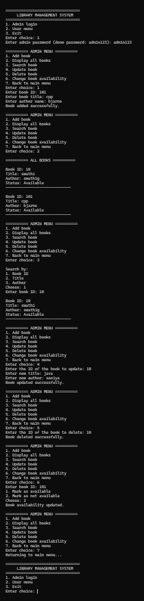

# Library Management System

A console-based Library Management System developed in **C++** using **Object-Oriented Programming (OOP)** principles. The application provides essential library operations, including book management, searching, updating records, and persistent data storage through file handling.

## Project Overview

The Library Management System is designed to simplify the management of book records through a menu-driven console interface. It demonstrates the practical application of core C++ programming concepts and object-oriented design.

## Key Features

- **Add Books:** Register new books in the library.
- **Search Books:** Find books using the available search functionality.
- **Update Records:** Modify existing book details.
- **Delete Books:** Remove book records from the system.
- **View Books:** Display available book information.
- **File Handling:** Store and retrieve book records for persistence between program runs.
- **Role-Based Menus:** Provide separate menus for administrative and user operations.

## Object-Oriented Programming Concepts

| Concept | Application |
|---|---|
| Classes and Objects | Organize book information and library operations. |
| Encapsulation | Protect data members and provide controlled access through member functions. |
| Inheritance | Reuse common functionality through base and derived classes. |
| Abstraction | Define a common interface using an abstract base class. |
| Polymorphism | Use overridden virtual functions to provide role-specific menus. |
| Constructors | Initialize objects when they are created. |
| File Handling | Read and write book records using files. |

## Technologies Used

- **Programming Language:** C++
- **Programming Paradigm:** Object-Oriented Programming
- **User Interface:** Console-based menu system
- **Data Storage:** File handling using `books.txt`

## Project Structure

```text
Library-Management-System/
├── LibraryManagement (2).cpp
├── books.txt
├── README.md
└── library-system.png.jpeg
```

## Learning Outcomes

This project demonstrates the practical use of classes, inheritance, abstraction, polymorphism, constructors, and file handling in C++. It also provides experience in designing a menu-driven application and managing persistent records.

## Sample Output


